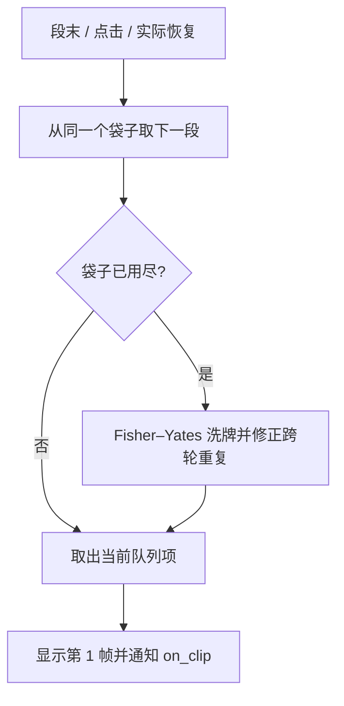

# 队列、可见性与计时

## 一个队列承接三类切段

片段配置按数组位置编号。每次袋子用尽时填入 `1..N`，做一次 Fisher–Yates 洗牌；若新袋首项等于上一袋末项，就与随机选择的后续项交换。`N = 1` 时跳过这一约束。

自动播完、点击和恢复最终都调用 `showNext`，再由 `takeNextClip` 推进同一个游标。队列状态在页面隐藏和灭屏期间保留，不重新洗牌，不重新播种。



“取出一次”发生在段开始，不等于完整播完。例如第 2 段刚开始就灭屏，它已经被消费，恢复时取第 3 个队列项。

## 三个门控与一个计时器

```text
running = started AND screenOn AND pageVisible AND NOT animPaused
```

| 输入 | 记录的状态 | 结果 |
|---|---|---|
| `set_screen_state("ON")` | `screenOn = true` | 其余门控也满足时才恢复 |
| 任何其他屏幕值，包括 AOD | `screenOn = false` | 暂停计时器，标记下次取新段 |
| `set_page_visible(false)` | `pageVisible = false` | 同上 |
| `set_page_visible(true)` | `pageVisible = true` | 仍需屏幕为 ON 且未手动暂停 |
| `set_paused(true)` | `animPaused = true` | 暂停；解除后同样从下一段开始 |
| 重复 ON / resume | 状态不变 | 已运行时不多取片段 |
| 隐藏时残留 timer callback | 状态不变 | 回调开头返回，不绘制、不消费队列 |
| 隐藏时点击 | 状态不变 | 返回 `false`，不消费队列 |

不能只靠页面钩子：AOD 可能不切走表盘页面，所以示例同时转发全局 `ScreenStateChangedCB`。本实现只认精确的 `"ON"`，没有推测其他固件状态名。

计时器仅创建一次。暂停时不销毁，恢复时不创建替代计时器，也不依赖未验证的 reset / change-period API。图片对象也只创建一次，逐帧改变 `src`。预先生成的是路径字符串，不是主动解码并常驻全部 PNG 像素；实际原生缓存行为需设备测量。

## 首帧与末帧

正常连续播放时：

```text
t=0       显示片段 A 第 1 帧
t=P       显示片段 A 第 2 帧
...
t=(n-1)P  显示片段 A 第 n 帧
t=nP      显示片段 B 第 1 帧
```

这样正常播放的首帧、末帧都各有完整一个周期；单帧片段也持续一个周期后切段。

原生 `resume()` 可能立即派发暂停前已到期的回调。若恢复时刚显示第 1 帧就马上推进，会看不到首帧。沿用的做法是：**已运行过的播放器每次恢复，以及每次点击切段，都让下一次 timer callback 只清除 `primeTick`，不推进背景帧。**

这不是精确重置定时器相位。点击或恢复后的首帧可能比普通帧多停留至约一个周期，并叠加固件调度延迟。`on_tick` 在此保护判断之前执行，允许状态层刷新。

默认 `new` 后立即初始化并 `start`，首轮不额外屏蔽第一回调，与原播放器一致。`new` 和第一次实际播放之间若长时间等待，计时器可能已经到期，而播放器尚无“已运行”标记，因此首次播放的第一帧可能很快推进。初始隐藏配置只提供门控，**不增加首次延迟启动的首帧时长保证**。若需要不同的首次启动语义，先单独验证固件计时器行为，再修改并补充对照。

## 随机数与复现

初始化沿用：

```text
state = floor(((os.time() % 2147483646) + seed_salt * 1.0) % 2147483646) + 1
```

生成器为 Park–Miller，模数 `2147483647`，乘数 `16807`。用 Schrage 算法拆分乘法，避免依赖位运算和大整数乘法；通过拒绝采样取 `1..limit`，避免简单取模引入的偏差。

盐在构建时选一次，运行时只初始化一次。它不是硬件熵；初始化秒时间和盐相同时，序列相同。`time = function() return 1700000000 end` 可用于桌面复现。这里不提供密码学随机性，也没有跨 Lua 实例持久化。固件是否在每次唤醒时重建实例，应通过实机观察判断。
